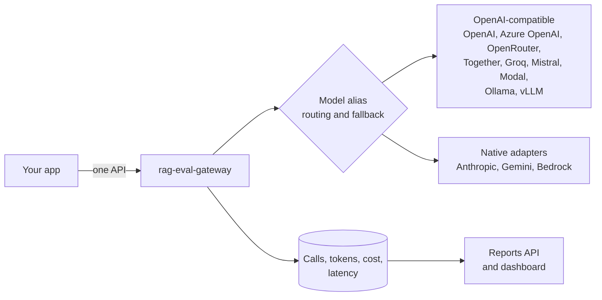

# rag-eval-gateway

[](https://github.com/rmkr-dev/rag-eval-gateway/actions/workflows/ci.yml)
[](https://github.com/rmkr-dev/rag-eval-gateway/actions/workflows/codeql.yml)

A Spring Boot 4 (Java 21) gateway that applications call instead of calling AI models directly.
One API in front of any provider, with routing and fallback, built-in cost and latency
tracking, per-client budgets, PII redaction and light eval hooks.



> Status: early development. The skeleton is in place; provider adapters land next.
> See the [roadmap](docs/roadmap.md).

## Run it

```bash
mvn spring-boot:run
curl localhost:8080/v1/models
curl localhost:8080/actuator/health
```

Or with Docker:

```bash
docker build -t rag-eval-gateway .
docker run -p 8080:8080 rag-eval-gateway
```

## Configure providers and aliases

Callers ask for a model alias. Each alias maps to an ordered list of provider targets, and
later targets are fallbacks. Any OpenAI-compatible service needs only configuration.

```yaml
gateway:
  providers:
    openrouter:
      base-url: https://openrouter.ai/api/v1
      api-key: ${OPENROUTER_API_KEY}
    local:
      base-url: http://ollama:11434/v1
    anthropic:
      type: anthropic
      base-url: https://api.anthropic.com
      api-key: ${ANTHROPIC_API_KEY}
      api-key-header: x-api-key
      api-key-prefix: ""
  models:
    chat-default:
      targets:
        - provider: openrouter
          model: meta-llama/llama-3.1-70b-instruct
        - provider: local
          model: llama3.1
```

| Provider property | Default | Purpose |
|---|---|---|
| `type` | `openai-compatible` | Wire protocol: `openai-compatible`, `anthropic`, `gemini`, `bedrock` |
| `base-url` | required | API base URL |
| `api-key` | none | Secret from the environment or Key Vault |
| `api-key-header` | `Authorization` | Header that carries the key |
| `api-key-prefix` | `Bearer ` | Prefix for the key value |
| `connect-timeout` / `read-timeout` | `5s` / `60s` | Upstream timeouts |

Startup fails if an alias points at a provider that is not configured.

## License

Apache License 2.0. See [LICENSE](LICENSE).
