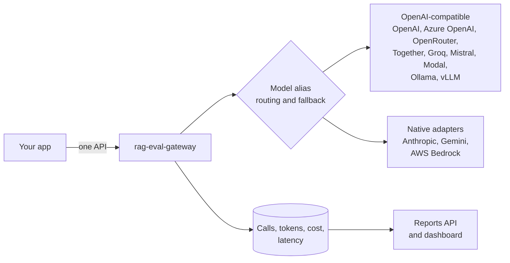

# rag-eval-gateway

[](https://github.com/rmkr-dev/rag-eval-gateway/actions/workflows/ci.yml)
[](https://github.com/rmkr-dev/rag-eval-gateway/actions/workflows/codeql.yml)

A Spring Boot 4 (Java 21) gateway that applications call instead of calling AI models directly.
One API in front of any provider, with routing and fallback, built-in cost and latency
tracking, per-client budgets, PII redaction and light eval hooks.



> Status: early development. Chat calls route through any OpenAI-compatible provider and
> native Anthropic, Gemini and AWS Bedrock adapters, with retries, fallback and streaming.
> Every call's cost and latency is stored in the gateway's own database, with reports and a
> dashboard on top. Entra authentication lands next. See the [roadmap](docs/roadmap.md).

## Run it

```bash
mvn spring-boot:run
curl localhost:8080/v1/models
curl localhost:8080/actuator/health
```

## Call it

```bash
curl localhost:8080/v1/chat/completions -H 'Content-Type: application/json' -d '{
  "model": "chat-default",
  "messages": [{"role": "user", "content": "What is retrieval augmented generation?"}],
  "max_tokens": 200
}'
```

```json
{
  "id": "gw-6f1c...",
  "model": "chat-default",
  "provider": "openrouter",
  "provider_model": "meta-llama/llama-3.1-70b-instruct",
  "message": {"role": "assistant", "content": "..."},
  "finish_reason": "stop",
  "usage": {"prompt_tokens": 14, "completion_tokens": 120, "total_tokens": 134}
}
```

The `X-Gateway-Calls` response header shows how many provider calls it took. Errors come back
as `application/problem+json`. How retries and fallback decide is in [docs/routing.md](docs/routing.md).

Add `"stream": true` to get server-sent events in the OpenAI chunk format, ending with
`data: [DONE]`, from any provider:

```bash
curl -N localhost:8080/v1/chat/completions -H 'Content-Type: application/json' -d '{
  "model": "chat-default", "stream": true,
  "messages": [{"role": "user", "content": "What is retrieval augmented generation?"}]
}'
```

## Track cost and latency

Every call is priced from a config price table and stored with its tokens, time to first
token and total time, in Postgres or in-memory H2 for local runs. Name the caller with
`X-Gateway-Client` and look a call up by its id:

```yaml
gateway:
  pricing:
    prices:
      - provider: openrouter
        model: meta-llama/llama-3.1-70b-instruct
        input: 0.40
        output: 0.40
```

```bash
curl localhost:8080/v1/calls/gw-6f1c...
```

Prices, storage, retention and the stored fields are in [docs/tracking.md](docs/tracking.md).

## Reports and dashboard

Cost, tokens, errors and p50/p95/p99 latency by client, model or provider, as JSON or per
hour or day, and a built-in dashboard at `/dashboard`:

```bash
curl 'localhost:8080/v1/reports/summary?group_by=client&range=7d'
curl 'localhost:8080/v1/reports/series?bucket=day&range=30d&zone=Asia/Kolkata'
```

Both are off by default until Entra auth puts sign-in in front of them. Turn them on with
`gateway.reports.enabled=true` and `gateway.reports.dashboard.enabled=true`, on a private
network only. Parameters, limits and how percentiles are computed are in
[docs/reports.md](docs/reports.md).

## Run with Docker

```bash
docker build -t rag-eval-gateway .
docker run -p 8080:8080 rag-eval-gateway
```

## Configure providers and aliases

Callers ask for a model alias. Each alias maps to an ordered list of provider targets, and
later targets are fallbacks. Any OpenAI-compatible service needs only configuration; Anthropic
and Gemini need only `type`, and Bedrock `type` plus `aws` region and credentials. Examples and
the native mappings are in
[docs/providers.md](docs/providers.md).

```yaml
gateway:
  providers:
    openrouter:
      base-url: https://openrouter.ai/api/v1
      api-key: ${OPENROUTER_API_KEY}
    local:
      base-url: http://ollama:11434/v1
    anthropic:
      type: anthropic
      base-url: https://api.anthropic.com
      api-key: ${ANTHROPIC_API_KEY}
  models:
    chat-default:
      targets:
        - provider: openrouter
          model: meta-llama/llama-3.1-70b-instruct
        - provider: anthropic
          model: claude-sonnet-4-5
        - provider: local
          model: llama3.1
```

| Provider property | Default | Purpose |
|---|---|---|
| `type` | `openai-compatible` | Wire protocol: `openai-compatible`, `anthropic`, `gemini`, `bedrock` |
| `base-url` | required | API base URL; Bedrock defaults to the region's `bedrock-runtime` endpoint |
| `api-key` | none | Secret from the environment or Key Vault |
| `api-key-header` | per type | `Authorization`, `x-api-key` or `x-goog-api-key` |
| `api-key-prefix` | per type | `Bearer ` for OpenAI-compatible and Bedrock, empty otherwise |
| `connect-timeout` / `read-timeout` | `5s` / `60s` | Upstream timeouts; when streaming, `read-timeout` is the longest gap between events |
| `chat-path` | per type | `/chat/completions`, `/v1/messages`, `/models` or `/model` |
| `headers` | none | Extra headers on every call, for example OpenRouter's `HTTP-Referer` |
| `default-max-tokens` | none | Completion cap when the caller sends none; Anthropic falls back to 4096 |
| `aws.region`, `aws.access-key-id`, `aws.secret-access-key`, `aws.session-token` | none | Bedrock SigV4 signing; blank keys fall back to the standard `AWS_*` variables |

Azure OpenAI works through its v1 API: `base-url: https://<resource>.openai.azure.com/openai/v1`,
`api-key-header: api-key`, `api-key-prefix: ""`, and the deployment name as `model`.

Startup fails if an alias points at a provider that is not configured, or if a Bedrock provider
has no region or credentials.

## License

Apache License 2.0. See [LICENSE](LICENSE).
