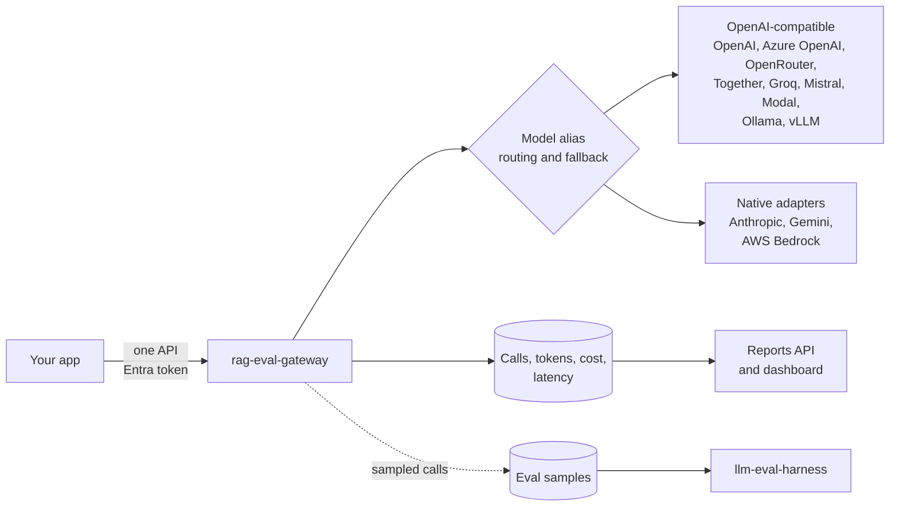

# rag-eval-gateway

[](https://github.com/rmkr-dev/rag-eval-gateway/actions/workflows/ci.yml)
[](https://github.com/rmkr-dev/rag-eval-gateway/actions/workflows/codeql.yml)

A Spring Boot 4 (Java 21) gateway that applications call instead of calling AI models directly.
One API in front of any provider, with routing and fallback, built-in cost and latency
tracking, per-client budgets, PII redaction and light eval hooks.



> Status: early development. Chat calls route through any OpenAI-compatible provider and
> native Anthropic, Gemini and AWS Bedrock adapters, with retries, fallback and streaming.
> Every call's cost and latency is stored in the gateway's own database, with reports and a
> dashboard on top, all behind Entra ID authentication, with per-client budgets, rate limits,
> PII redaction and eval sampling for llm-eval-harness, and Kustomize manifests for AKS. A
> docs pass and v1.0.0 come next. See the [roadmap](docs/roadmap.md).

## Run it

Locally, without Entra:

```bash
mvn spring-boot:run -Dspring-boot.run.profiles=local
curl localhost:8080/v1/models
curl localhost:8080/actuator/health
```

The starter comes from GitHub Packages, so Maven needs a server `github-entra-security` in
`~/.m2/settings.xml` with a token that has `read:packages`
([how](https://github.com/rmkr-dev/spring-security-jwt-starter/blob/main/docs/releasing.md#installing)).

## Authentication

Everywhere else every call needs an Entra ID access token. Set the tenant and the gateway's
app registration:

```bash
export ENTRA_SECURITY_TENANTID=<tenant-id> ENTRA_SECURITY_CLIENTID=<gateway-client-id>
```

Callers need the `Gateway.Call` app role, and reports and the dashboard need
`Gateway.Reports`. Without a token the answer is `401`, without the role `403`. The client
recorded for each call comes from the token (`azp` or `appid`), not from a header. Roles,
client names and the local profile are in [docs/auth.md](docs/auth.md).

## Call it

```bash
curl localhost:8080/v1/chat/completions -H "Authorization: Bearer $TOKEN" \
  -H 'Content-Type: application/json' -d '{
  "model": "chat-default",
  "messages": [{"role": "user", "content": "What is retrieval augmented generation?"}],
  "max_tokens": 200
}'
```

```json
{
  "id": "gw-6f1c...",
  "model": "chat-default",
  "provider": "openrouter",
  "provider_model": "meta-llama/llama-3.1-70b-instruct",
  "message": {"role": "assistant", "content": "..."},
  "finish_reason": "stop",
  "usage": {"prompt_tokens": 14, "completion_tokens": 120, "total_tokens": 134}
}
```

The `X-Gateway-Calls` response header shows how many provider calls it took. Errors come back
as `application/problem+json`. How retries and fallback decide is in [docs/routing.md](docs/routing.md).

Add `"stream": true` to get server-sent events in the OpenAI chunk format, ending with
`data: [DONE]`, from any provider:

```bash
curl -N localhost:8080/v1/chat/completions -H "Authorization: Bearer $TOKEN" \
  -H 'Content-Type: application/json' -d '{
  "model": "chat-default", "stream": true,
  "messages": [{"role": "user", "content": "What is retrieval augmented generation?"}]
}'
```

## Track cost and latency

Every call is priced from a config price table and stored with its tokens, time to first
token and total time, in Postgres or in-memory H2 for local runs, under the client named by
the caller's token. Look a call up by its id:

```yaml
gateway:
  pricing:
    prices:
      - provider: openrouter
        model: meta-llama/llama-3.1-70b-instruct
        input: 0.40
        output: 0.40
```

```bash
curl -H "Authorization: Bearer $TOKEN" localhost:8080/v1/calls/gw-6f1c...
```

Prices, storage, retention and the stored fields are in [docs/tracking.md](docs/tracking.md).

## Reports and dashboard

Cost, tokens, errors and p50/p95/p99 latency by client, model or provider, as JSON or per
hour or day, and a built-in dashboard at `/dashboard`:

```bash
curl -H "Authorization: Bearer $TOKEN" 'localhost:8080/v1/reports/summary?group_by=client&range=7d'
curl -H "Authorization: Bearer $TOKEN" 'localhost:8080/v1/reports/series?bucket=day&range=30d&zone=Asia/Kolkata'
```

Both are on by default and need the `Gateway.Reports` app role. The dashboard shows UTC
unless `?zone=` says otherwise. Parameters, limits and how percentiles are computed are in
[docs/reports.md](docs/reports.md).

## Budgets and rate limits

Give each client a token or cost budget per day or month, and a request or token rate per
minute. Over a limit the call is refused before any provider is asked, with `429` and
`Retry-After`:

```yaml
gateway:
  budgets:
    default:
      daily-cost: 5.00
    clients:
      billing-api:
        monthly-cost: 300
  rate-limits:
    default:
      requests-per-minute: 60
```

Budgets count the gateway's own stored usage, so they hold across restarts and replicas. Nothing
is limited until a limit is set. Details, the warning header and multi-replica behaviour are in
[docs/budgets.md](docs/budgets.md).

## PII redaction

Find emails, phone numbers, cards, IBANs, SSNs, IP addresses, PAN and Aadhaar numbers, or your
own patterns, in prompts before any provider sees them. Per client or model alias, choose
`mask`, `redact` (`[EMAIL_1]`) or `block` (`422`):

```yaml
gateway:
  pii:
    mode: redact
    clients:
      billing-api: block
```

Plain and streamed calls are covered, only counts are stored, and provider error details are
scrubbed before logging. Off until a mode is set. Details, custom detectors and placeholder
restore are in [docs/pii-redaction.md](docs/pii-redaction.md).

## Eval hooks

Keep a sample of real calls, with the context your app retrieved, and score them with
[llm-eval-harness](https://github.com/rmkr-dev/llm-eval-harness):

```yaml
gateway:
  eval:
    enabled: true
    sample-rate: 0.05
    clients:
      search-api: 1.0
```

Send the retrieved passages as `eval_context` in the chat request; they are never sent to a
provider. Samples are written after the answer completes through a bounded queue, with the
prompt as the provider saw it after PII redaction. `GET /v1/eval/samples?format=fixtures`
returns a zip that `llm-eval --fixtures` reads as is, and `POST /v1/eval/scores` takes its JSON
report back. Off by default. Details are in [docs/eval-hooks.md](docs/eval-hooks.md).

## Run with Docker

```bash
docker build -t rag-eval-gateway \
  --secret id=maven-settings,src=$HOME/.m2/settings.xml --secret id=github-token,env=GITHUB_TOKEN .
docker run -p 8080:8080 -e ENTRA_SECURITY_TENANTID=... -e ENTRA_SECURITY_CLIENTID=... rag-eval-gateway
```

The secrets give the build access to GitHub Packages and never end up in the image. Add
`-e SPRING_PROFILES_ACTIVE=local` instead of the Entra ids to run without auth.

## Deploy to AKS

Kustomize manifests (no Helm) with a `dev` and `prod` overlay. Pods get secrets from Azure Key
Vault through workload identity, run non-root on a read-only filesystem, and scale with an
HPA behind a PDB and default-deny network policies:

```bash
scripts/aks-preflight.sh dev --server-dry-run
kubectl apply -k deploy/k8s/overlays/dev
```

The **Deploy to AKS** workflow does the same from GitHub with OIDC login, on demand only.
Onboarding, configuration and what the manifests enforce are in
[docs/deployment-aks.md](docs/deployment-aks.md).

## Configure providers and aliases

Callers ask for a model alias. Each alias maps to an ordered list of provider targets, and
later targets are fallbacks. Any OpenAI-compatible service needs only configuration; Anthropic
and Gemini need only `type`, and Bedrock `type` plus `aws` region and credentials. Examples and
the native mappings are in
[docs/providers.md](docs/providers.md).

```yaml
gateway:
  providers:
    openrouter:
      base-url: https://openrouter.ai/api/v1
      api-key: ${OPENROUTER_API_KEY}
    local:
      base-url: http://ollama:11434/v1
    anthropic:
      type: anthropic
      base-url: https://api.anthropic.com
      api-key: ${ANTHROPIC_API_KEY}
  models:
    chat-default:
      targets:
        - provider: openrouter
          model: meta-llama/llama-3.1-70b-instruct
        - provider: anthropic
          model: claude-sonnet-4-5
        - provider: local
          model: llama3.1
```

| Provider property | Default | Purpose |
|---|---|---|
| `type` | `openai-compatible` | Wire protocol: `openai-compatible`, `anthropic`, `gemini`, `bedrock` |
| `base-url` | required | API base URL; Bedrock defaults to the region's `bedrock-runtime` endpoint |
| `api-key` | none | Secret from the environment or Key Vault |
| `api-key-header` | per type | `Authorization`, `x-api-key` or `x-goog-api-key` |
| `api-key-prefix` | per type | `Bearer ` for OpenAI-compatible and Bedrock, empty otherwise |
| `connect-timeout` / `read-timeout` | `5s` / `60s` | Upstream timeouts; when streaming, `read-timeout` is the longest gap between events |
| `chat-path` | per type | `/chat/completions`, `/v1/messages`, `/models` or `/model` |
| `headers` | none | Extra headers on every call, for example OpenRouter's `HTTP-Referer` |
| `default-max-tokens` | none | Completion cap when the caller sends none; Anthropic falls back to 4096 |
| `aws.region`, `aws.access-key-id`, `aws.secret-access-key`, `aws.session-token` | none | Bedrock SigV4 signing; blank keys fall back to the standard `AWS_*` variables |

Azure OpenAI works through its v1 API: `base-url: https://<resource>.openai.azure.com/openai/v1`,
`api-key-header: api-key`, `api-key-prefix: ""`, and the deployment name as `model`.

Startup fails if an alias points at a provider that is not configured, or if a Bedrock provider
has no region or credentials.

## License

Apache License 2.0. See [LICENSE](LICENSE).
