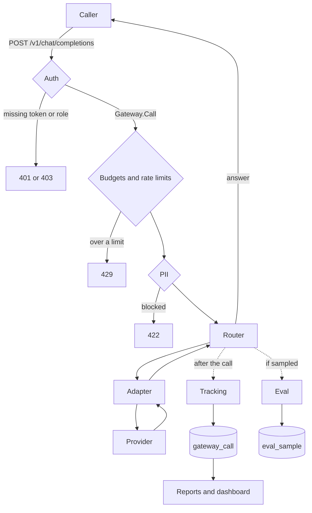

# Architecture

One chat call crosses the gateway in a fixed order. Each step has its own page. This one
only shows how they connect.

| Step | On this path | Page |
|---|---|---|
| Auth | An Entra access token, except the `local` profile and the health probes. The client name comes from the token. | [auth.md](auth.md) |
| Budgets and rate limits | Checked before any provider is asked. Nothing is limited until a limit is set. | [budgets.md](budgets.md) |
| PII | Runs on the prompt after the limits. Off until a mode is set. `block` stops the call; `mask` and `redact` change what the provider sees. | [pii-redaction.md](pii-redaction.md) |
| Router | Resolves the model alias and walks its targets. Retries transient failures. `fallback-on-bad-request` is off unless that alias sets it, and then a 400, 413 or 422 moves to the next target. | [routing.md](routing.md) |
| Adapter | `openai-compatible`, `anthropic`, `gemini` or `bedrock`. Bedrock requests are signed in the gateway with SigV4. There is no AWS SDK. | [providers.md](providers.md) |
| Tracking | Stores tokens, cost and latency after the call finishes, including failures. The database is not on the request path. | [tracking.md](tracking.md) |
| Eval | The sample decision is made when the call arrives. A successful sampled call is written after the answer, as the provider saw it. Off by default. | [eval-hooks.md](eval-hooks.md) |
| Reports | Not on the chat path. They read `gateway_call`. On by default, and they need `Gateway.Reports` once auth is on. | [reports.md](reports.md) |

A call that is refused (no token, wrong role, over budget, over rate, blocked for PII, or an
unknown alias) never reaches a provider. `"stream": true` follows the same order until the
first token. After that the answer stays with the provider that produced it.

On AKS the process is the same binary. Traffic comes in through an ingress-nginx Ingress.
Non-secret settings come from a ConfigMap, and the database password and provider keys come
from Key Vault through workload identity. The manifests are Kustomize only, with no Helm
chart, and the image is published to Azure Container Registry. See
[deployment-aks.md](deployment-aks.md).

Milestones through this docs pass are done. v1.0.0 is what remains. See
[roadmap.md](roadmap.md).
