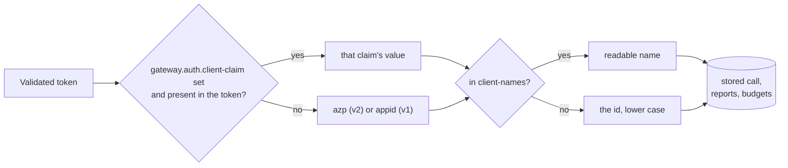

# Authentication

Every API call needs an Entra ID access token. Token validation, role mapping and the 401 and
403 problem responses come from
[spring-security-jwt-starter](https://github.com/rmkr-dev/spring-security-jwt-starter) 1.0.0.
The gateway adds two roles and takes the caller's name for tracking from the token.

```mermaid
sequenceDiagram
    participant App as Calling app
    participant E as Entra ID
    participant GW as Gateway
    participant P as Provider
    App->>E: client credentials (or user sign-in)<br/>scope api://gateway/.default
    E-->>App: access token with app role Gateway.Call
    App->>GW: POST /v1/chat/completions<br/>Authorization: Bearer ...
    GW->>GW: validate signature (cached JWKS), issuer,<br/>audience, tenant, expiry
    GW->>GW: map Gateway.Call to ROLE_GATEWAY_CALLER<br/>@Secured check
    GW->>GW: client = azp / appid from the token
    GW->>P: routed call
    P-->>GW: answer
    GW-->>App: answer, Server-Timing: auth;dur=...
```

No token, or a bad one, is a `401`. A valid token without the role is a `403`. Both are
`application/problem+json`, and the provider is never called. Validated tokens and keys are
cached, so the auth step is a few milliseconds once warm; the `Server-Timing` header shows it
on every response.

## Roles

| Role | Entra app role | Opens |
|---|---|---|
| `GATEWAY_CALLER` | `Gateway.Call` | `POST /v1/chat/completions`, `GET /v1/models`, its own `GET /v1/calls/{id}` |
| `GATEWAY_REPORTS` | `Gateway.Reports` | `GET /v1/reports/*`, `GET /dashboard`, any `GET /v1/calls/{id}` |

`/actuator/health/**` and `/actuator/info` stay public for probes. A caller that asks for
someone else's call id gets a `404`, the same as an unknown id.

Create both app roles on the gateway's app registration (allowed member types: applications for
services, users and groups for people who read the dashboard) and assign them. Groups can be
mapped too, with `entra.security.group-role-mappings`.

## Configuration

```yaml
entra:
  security:
    tenant-id: ${ENTRA_TENANT_ID}        # or env ENTRA_SECURITY_TENANTID
    client-id: ${GATEWAY_CLIENT_ID}      # the gateway's app registration, or ENTRA_SECURITY_CLIENTID
    app-role-mappings:                   # the defaults, already in application.yml
      "[Gateway.Call]": [GATEWAY_CALLER]
      "[Gateway.Reports]": [GATEWAY_REPORTS]

gateway:
  auth:
    client-claim: ""                     # blank: azp (v2) or appid (v1)
    client-names:
      "[11111111-1111-1111-1111-111111111111]": billing-api
```

Startup fails without `tenant-id` and `client-id`. Everything else under `entra.security`
works as the starter documents: audiences, v1 tokens, validation modes, role patterns.

## Who the caller is



The `X-Gateway-Client` header is ignored while auth is on, so a caller cannot bill its calls
to someone else. Values that are not 1-64 letters, digits, `.`, `_`, `:` or `-` are stored as
`anonymous`.

## The dashboard

`/dashboard` is a plain page behind the same bearer token check, so a browser needs something
in front that signs the user in and adds the token, such as an ingress auth proxy. From a
terminal:

```bash
TOKEN=$(az account get-access-token --scope api://<gateway-client-id>/.default --query accessToken -o tsv)
curl -H "Authorization: Bearer $TOKEN" 'https://gateway.example/v1/reports/summary?group_by=client'
```

## Local development without Entra

```bash
mvn spring-boot:run -Dspring-boot.run.profiles=local
```

The `local` profile sets `entra.security.enabled=false`. Every endpoint is open, callers are
named by `X-Gateway-Client`, and the gateway logs a warning at startup. Never run it on a
shared network.

## Tests

Tests use the starter's mock authority (`@AutoConfigureEntraMockAuthority`): tokens are signed
with a local key and validated against a local JWKS, so no tenant is needed. See
`AuthEndpointTests`.
