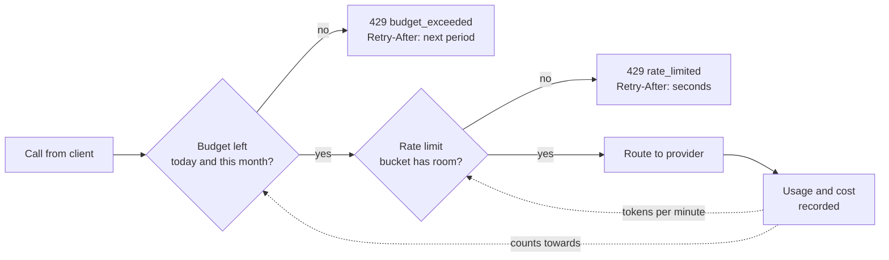
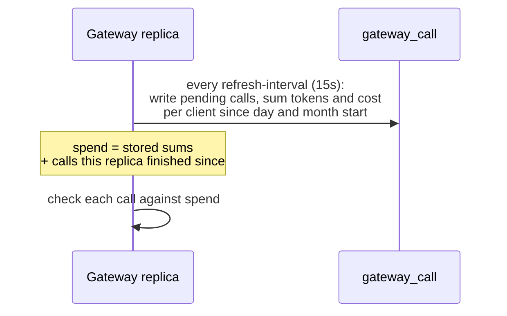

# Budgets and rate limits

Each client, named by its token as in [auth.md](auth.md#who-the-caller-is), can have a token
and cost budget per day and per month, and a request and token rate per minute. Both are
checked before any provider is asked, so a refused call costs nothing. Nothing is limited until
you configure a limit.



## Configuration

```yaml
gateway:
  budgets:
    zone: UTC              # where days and months start
    warn-at: 0.8           # X-Gateway-Budget-Warning from 80% of a budget
    default:               # every client without its own entry
      daily-cost: 5.00
    clients:
      billing-api:
        monthly-cost: 300
        daily-tokens: 2000000
      batch-indexer:
        unlimited: true
  rate-limits:
    default:
      requests-per-minute: 60
    clients:
      billing-api:
        requests-per-minute: 600
        tokens-per-minute: 400000
```

| Budget | Counts |
|---|---|
| `daily-tokens`, `monthly-tokens` | prompt plus completion tokens |
| `daily-cost`, `monthly-cost` | cost from the [price table](tracking.md#prices), in its currency; unpriced calls count tokens only |

| Rate | Counts |
|---|---|
| `requests-per-minute` | chat calls, taken when the call arrives |
| `tokens-per-minute` | prompt plus completion tokens, taken when the call ends |

- A client entry replaces the default completely. Leave a field out for no limit of that
  kind, set `unlimited: true` for none at all, or `0` on a budget to block the client.
- Client names match the names stored for calls, ignoring case. Callers that cannot be named
  share the `anonymous` budget and bucket.
- `gateway.budgets.enabled: false` or `gateway.rate-limits.enabled: false` switches checks off
  without removing the limits.
- Budgets read stored usage, so they need `gateway.tracking.enabled` (the default). Startup
  fails if a budget is set while tracking is off.

## What callers see

Both refusals are `429` problems with a `Retry-After` header in seconds and a `code` to tell
them apart:

```json
{
  "type": "about:blank",
  "title": "Budget used up",
  "status": 429,
  "detail": "Client 'billing-api' has used its daily-cost budget of 5.00 USD",
  "code": "budget_exceeded",
  "limit": "daily-cost",
  "client": "billing-api",
  "resets_at": "2026-11-02T00:00:00Z"
}
```

A rate limit has `"title": "Rate limit reached"`, `"code": "rate_limited"` and a `limit` of
`requests-per-minute` or `tokens-per-minute`, without `resets_at`. Streaming calls are refused
the same way, before any event is sent.

From `warn-at` of any budget, successful answers carry `X-Gateway-Budget-Warning`, naming the
most used budget, for example `daily-cost=85%`. The gateway also logs once per client and
period when a budget passes `warn-at` and when it runs out.

## How spend is counted



- Spend comes from the stored calls, so it survives restarts and covers every replica.
- The call that crosses a budget finishes; the next one is refused. Spend from other replicas
  shows up within one `refresh-interval`, so with several replicas a client can overshoot by
  what the others serve in that time.
- A call counts in the period it started in.
- If the database cannot be read, calls go through on the last known numbers and a warning is
  logged. A database problem never stops the gateway answering.

## Rate limits across replicas

Rate limits are token buckets that refill evenly over a minute, kept in memory. A full bucket
allows a burst of one minute's worth. Each replica counts on its own, so with three replicas a
client can make up to three times its rate; divide the rate by the replica count, or register
your own `RateLimitStore` bean to share buckets, for example in Redis:

```java
public interface RateLimitStore {
    Duration tryTake(String key, long perMinute, long permits);   // ZERO when taken
    void take(String key, long perMinute, long permits);          // may go below zero
    Duration untilAvailable(String key, long perMinute);          // ZERO when above zero
}
```

The gateway itself needs no Redis.
