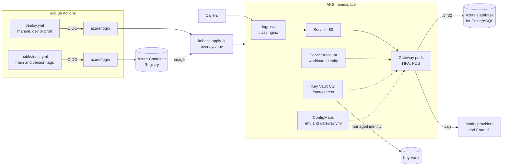

# Deploying to AKS

The gateway ships as plain Kustomize manifests: a base and a `dev` and `prod` overlay. There is
no Helm chart. An ingress-nginx Ingress is the front door. Images are built in GitHub Actions
and pushed to Azure Container Registry with OIDC, so no registry password is stored. Pods read
secrets straight from Azure Key Vault through workload identity, so no password or key lives
in the repository, in a Kubernetes Secret or in GitHub.



## Layout

```text
deploy/k8s/
  base/                 Deployment, Service, Ingress, ServiceAccount, SecretProviderClass,
                        HPA, PDB, NetworkPolicy, gateway.env, gateway.yml
  overlays/dev/         1 replica (HPA 1-3), 768Mi, eval sampling 20%, debug logs
  overlays/prod/        3 replicas (HPA 3-12), 2Gi, PII redaction on
scripts/aks-preflight.sh
.github/workflows/deploy.yml
.github/workflows/publish-acr.yml
```

## How configuration reaches the pod

| Source | Mounted as | Holds |
|---|---|---|
| `gateway.env` (base, merged by the overlay) | environment variables | Database URL and user, Entra tenant and client id, health groups, JVM options |
| `gateway.yml` | `/config/gateway.yml` | Providers, model aliases, any other `gateway.*` setting |
| Key Vault through `SecretProviderClass` | files in `/mnt/secrets` | Database password and provider API keys |

Spring reads `/mnt/secrets` as a config tree
(`SPRING_CONFIG_IMPORT=optional:configtree:/mnt/secrets/` in `gateway.env`). The file name
is the property name. The Key Vault secret name and that file name are not the same:
`objectAlias` in `secretproviderclass.yaml` is the file name.

| Key Vault secret | File in `/mnt/secrets` | Spring sees |
|---|---|---|
| `gateway-db-password` | `spring.datasource.password` | the property `spring.datasource.password` |
| `openrouter-api-key` | `OPENROUTER_API_KEY` | `${OPENROUTER_API_KEY}` in `gateway.yml` |
| `anthropic-api-key` | `ANTHROPIC_API_KEY` | `${ANTHROPIC_API_KEY}` in `gateway.yml` |

`SPRING_DATASOURCE_URL` and `SPRING_DATASOURCE_USERNAME` come from `gateway.env`. The
password does not. A file left named `gateway-db-password` would not set
`spring.datasource.password`. To add a provider, add its Key Vault object with an
`objectAlias` and its entry in `gateway.yml`.

ConfigMap names carry a content hash, so changing either file rolls the pods. Key Vault values
are read when a pod starts; restart the deployment after rotating one.

## Onboarding

One time per cluster and environment. Names below are examples.

1. **Cluster add-ons.** Turn on the OIDC issuer, workload identity and the Key Vault provider:

   ```bash
   az aks update -g rg-ai -n aks-ai --enable-oidc-issuer --enable-workload-identity
   az aks enable-addons -g rg-ai -n aks-ai --addons azure-keyvault-secrets-provider
   ```

2. **Pod identity.** Create a user-assigned managed identity, give it `Key Vault Secrets User`
   on the vault, and federate it with the gateway's service account:

   ```bash
   az identity create -g rg-ai -n id-gateway-dev
   az identity federated-credential create -g rg-ai --identity-name id-gateway-dev \
     --name aks-gateway-dev \
     --issuer "$(az aks show -g rg-ai -n aks-ai --query oidcIssuerProfile.issuerUrl -o tsv)" \
     --subject system:serviceaccount:rag-eval-gateway-dev:rag-eval-gateway
   ```

3. **Secrets.** Put `gateway-db-password`, `openrouter-api-key` and `anthropic-api-key` (or
   your providers' keys) in the vault. Those names are the Key Vault objects. The pod mounts
   them under the aliases in the table above (`spring.datasource.password`,
   `OPENROUTER_API_KEY`, `ANTHROPIC_API_KEY`).

4. **Namespace.** `kubectl create namespace rag-eval-gateway-dev`. The manifests do not create
   it, so the namespace and its quotas stay with the platform team.

5. **Ingress.** Install [ingress-nginx](https://kubernetes.github.io/ingress-nginx/deploy/)
   so its namespace is `ingress-nginx` and the IngressClass is `nginx`. The NetworkPolicy
   only accepts traffic from that namespace. Create the TLS secret in the gateway namespace.
   The manifests do not install cert-manager:

   ```bash
   kubectl create secret tls rag-eval-gateway-tls \
     --cert=tls.crt --key=tls.key -n rag-eval-gateway-dev
   ```

   Give the cluster a way to pull from the registry, for example **AcrPull** on the kubelet
   identity, or attach the registry to the cluster. The manifests do not set
   `imagePullSecrets`.

6. **Fill in the overlay.** Replace every `REPLACE_ME` in `overlays/<env>`: the managed
   identity client id, Key Vault name and tenant in `identity.yaml`, the database URL and the
   gateway's Entra ids in `gateway.env`, the registry in `kustomization.yaml`, and the host
   and TLS secret name in `ingress.yaml`. Dev starts from `gateway-dev.REPLACE_ME` and prod
   from `gateway.REPLACE_ME`. A typical secret name is `rag-eval-gateway-tls`. None of these
   is a secret. The preflight refuses to deploy while any placeholder is left, including the
   Ingress host and TLS secret.

7. **Deploy identity.** Create a second identity (or app registration) for GitHub with a
   federated credential for `repo:rmkr-dev/rag-eval-gateway:environment:dev`, the `Azure
   Kubernetes Service Cluster User Role`, and Kubernetes RBAC to apply in the namespace and
   read CRDs, CSI drivers and webhook configurations. Then create the `dev` GitHub
   environment with these variables:

   | Variable | Example |
   |---|---|
   | `AZURE_CLIENT_ID`, `AZURE_TENANT_ID`, `AZURE_SUBSCRIPTION_ID` | ids of the deploy identity |
   | `AKS_RESOURCE_GROUP`, `AKS_CLUSTER_NAME` | `rg-ai`, `aks-ai` |
   | `IMAGE_REPOSITORY` | `myacr.azurecr.io/rag-eval-gateway` |

   `IMAGE_REPOSITORY` is the image **Publish image to ACR** pushes. It has to match the
   registry filled in under `images.newName` in the overlay.

Repeat steps 2 to 7 for `prod`, and add required reviewers to the `prod` environment.
Publishing the image is once per registry; see below.

## Publish the image

**Publish image to ACR** (`.github/workflows/publish-acr.yml`) runs on every push to `main`,
on tags that start with `v`, and from the Actions tab when the selected ref is `main` or a
`v*` tag. It logs in with OIDC (`azure/login`), runs `az acr login`, builds with the same
GitHub Packages secret CI uses, and pushes `rag-eval-gateway`. There is no registry password
and no admin user.

| Event | Tags pushed |
|---|---|
| Push to `main` | `main` and the seven-character SHA |
| Tag `v*` | that tag and the seven-character SHA |
| workflow_dispatch | the seven-character SHA, `main` when the ref is `main`, and the optional tag input |

One time, create an identity with **AcrPush** on the registry and a federated credential for
`repo:rmkr-dev/rag-eval-gateway:environment:acr`:

```bash
az identity create -g rg-ai -n id-gateway-acr
az role assignment create --role AcrPush \
  --scope "$(az acr show -n myacr --query id -o tsv)" \
  --assignee-object-id "$(az identity show -g rg-ai -n id-gateway-acr --query principalId -o tsv)" \
  --assignee-principal-type ServicePrincipal
az identity federated-credential create -g rg-ai --identity-name id-gateway-acr \
  --name github-acr \
  --issuer https://token.actions.githubusercontent.com \
  --subject repo:rmkr-dev/rag-eval-gateway:environment:acr
```

Then create the `acr` GitHub environment with these variables (they are not secrets):

| Variable | Example |
|---|---|
| `AZURE_CLIENT_ID`, `AZURE_TENANT_ID`, `AZURE_SUBSCRIPTION_ID` | ids of the identity that can push |
| `ACR_NAME` | `myacr` |
| `ACR_LOGIN_SERVER` | `myacr.azurecr.io` |

`ACR_LOGIN_SERVER` must be `ACR_NAME` plus `.azurecr.io`. The image repository is
`<ACR_LOGIN_SERVER>/rag-eval-gateway`. Leave the `acr` environment without required
reviewers if a push to `main` should publish on its own.

The build reads `spring-security-jwt-starter` from GitHub Packages the same way CI does,
with `GITHUB_TOKEN` as a BuildKit secret. The token is not stored in the image.

## Deploy

From the Actions tab run **Deploy to AKS** with `dev` or `prod` and, optionally, an image
tag. It logs in with OIDC, runs the preflight with a server dry run, applies the overlay and
waits for the rollout. It never runs on push. Leave the image tag empty to keep the overlay's
tag. Dev stays on `main`. Prod stays on `v1.0.0`, the tag **Publish image to ACR** pushes
for git tag `v1.0.0` together with the seven-character SHA. Pass a tag only to select another
tag that workflow pushes (`main`, a short SHA, or a `v*` tag).

From a workstation with access to the cluster:

```bash
scripts/aks-preflight.sh dev --server-dry-run
kubectl apply -k deploy/k8s/overlays/dev
kubectl rollout status deployment/rag-eval-gateway -n rag-eval-gateway-dev
```

The preflight checks kubectl and kustomize, the current context (`--context` to insist on
one), the namespace, the `ingress-nginx` namespace, the `nginx` IngressClass, the TLS secret
named by the Ingress, the workload identity webhook, the SecretProviderClass CRD, the CSI
driver and Key Vault provider pods, that the overlay renders with an Ingress (class `nginx`,
a host and a TLS secret), and that no placeholder is left. `--render-only` skips the cluster,
which is what CI runs.

## What the manifests enforce

- **Health.** Startup and liveness use `/actuator/health/liveness`; readiness uses
  `/actuator/health/readiness`, which includes the database, so a pod that loses Postgres
  leaves the Service without being restarted. Startup allows three minutes.
- **Security.** Runs as user 10001 with a read-only root filesystem (a small `/tmp` volume
  for the JVM), no privilege escalation, all capabilities dropped and the runtime default
  seccomp profile.
- **Memory.** The memory request equals the limit and the heap is 75% of it
  (`MaxRAMPercentage`), so changing the limit in an overlay resizes the heap. The JVM exits on
  `OutOfMemoryError` and Kubernetes restarts it.
- **Availability.** Rolling updates add a pod before removing one, a `preStop` pause lets the
  Service drain before graceful shutdown, pods spread across zones and nodes, the PDB keeps
  all but one pod during node drains, and the HPA scales on 70% CPU.
- **Ingress.** Class `nginx`, TLS, and path `/` to Service port `http` (container port 8080).
  The host and the TLS secret name come from the overlay. Proxy buffering is off and the read
  timeout is an hour, so a streamed chat is not held or cut at the controller's default.
  Request bodies up to 8Mi are accepted. Bring your own TLS secret.
- **Network.** Everything in the namespace is denied by default. The gateway takes traffic on
  8080 only from the `ingress-nginx` namespace, and reaches DNS, Postgres on 5432 inside
  `10.0.0.0/8`, and HTTPS on 443. Patch `networkpolicy.yaml` in an overlay for another
  ingress namespace, a narrower database subnet or in-cluster model servers.
