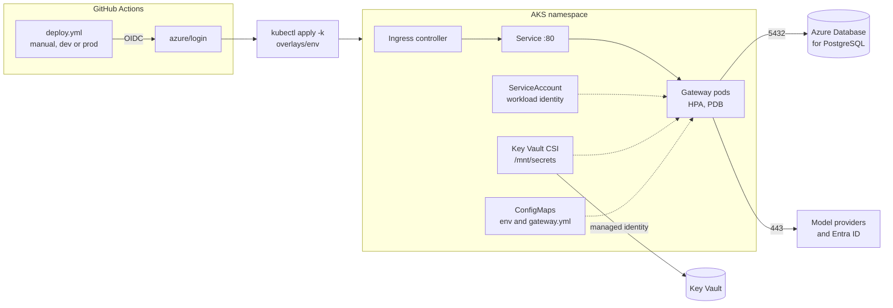

# Deploying to AKS

The gateway ships as plain Kustomize manifests: a base and a `dev` and `prod` overlay. There is
no Helm chart. Pods read secrets straight from Azure Key Vault through workload identity, so
no password or key lives in the repository, in a Kubernetes Secret or in GitHub.



## Layout

```text
deploy/k8s/
  base/                 Deployment, Service, ServiceAccount, SecretProviderClass,
                        HPA, PDB, NetworkPolicy, gateway.env, gateway.yml
  overlays/dev/         1 replica (HPA 1-3), 768Mi, eval sampling 20%, debug logs
  overlays/prod/        3 replicas (HPA 3-12), 2Gi, PII redaction on
scripts/aks-preflight.sh
.github/workflows/deploy.yml
```

## How configuration reaches the pod

| Source | Mounted as | Holds |
|---|---|---|
| `gateway.env` (base, merged by the overlay) | environment variables | Database URL and user, Entra tenant and client id, health groups, JVM options |
| `gateway.yml` | `/config/gateway.yml` | Providers, model aliases, any other `gateway.*` setting |
| Key Vault through `SecretProviderClass` | files in `/mnt/secrets` | Database password and provider API keys |

Spring reads `/mnt/secrets` as a config tree: each file name is a property or placeholder.
The Key Vault secret `openrouter-api-key` is mounted as `OPENROUTER_API_KEY`, which fills
`${OPENROUTER_API_KEY}` in `gateway.yml`. To add a provider, add its Key Vault object with an
`objectAlias` in `secretproviderclass.yaml` and its entry in `gateway.yml`.

ConfigMap names carry a content hash, so changing either file rolls the pods. Key Vault values
are read when a pod starts; restart the deployment after rotating one.

## Onboarding

One time per cluster and environment. Names below are examples.

1. **Cluster add-ons.** Turn on the OIDC issuer, workload identity and the Key Vault provider:

   ```bash
   az aks update -g rg-ai -n aks-ai --enable-oidc-issuer --enable-workload-identity
   az aks enable-addons -g rg-ai -n aks-ai --addons azure-keyvault-secrets-provider
   ```

2. **Pod identity.** Create a user-assigned managed identity, give it `Key Vault Secrets User`
   on the vault, and federate it with the gateway's service account:

   ```bash
   az identity create -g rg-ai -n id-gateway-dev
   az identity federated-credential create -g rg-ai --identity-name id-gateway-dev \
     --name aks-gateway-dev \
     --issuer "$(az aks show -g rg-ai -n aks-ai --query oidcIssuerProfile.issuerUrl -o tsv)" \
     --subject system:serviceaccount:rag-eval-gateway-dev:rag-eval-gateway
   ```

3. **Secrets.** Put `gateway-db-password`, `openrouter-api-key` and `anthropic-api-key` (or
   your providers' keys) in the vault.

4. **Namespace.** `kubectl create namespace rag-eval-gateway-dev`. The manifests do not create
   it, so the namespace and its quotas stay with the platform team.

5. **Fill in the overlay.** Replace every `REPLACE_ME` in `overlays/<env>`: the managed
   identity client id, Key Vault name and tenant in `identity.yaml`, the database URL and the
   gateway's Entra ids in `gateway.env`, and the registry in `kustomization.yaml`. None of
   these is a secret. The preflight refuses to deploy while any placeholder is left.

6. **Deploy identity.** Create a second identity (or app registration) for GitHub with a
   federated credential for `repo:rmkr-dev/rag-eval-gateway:environment:dev`, the `Azure
   Kubernetes Service Cluster User Role`, and Kubernetes RBAC to apply in the namespace and
   read CRDs, CSI drivers and webhook configurations. Then create the `dev` GitHub
   environment with these variables:

   | Variable | Example |
   |---|---|
   | `AZURE_CLIENT_ID`, `AZURE_TENANT_ID`, `AZURE_SUBSCRIPTION_ID` | ids of the deploy identity |
   | `AKS_RESOURCE_GROUP`, `AKS_CLUSTER_NAME` | `rg-ai`, `aks-ai` |
   | `IMAGE_REPOSITORY` | `myacr.azurecr.io/rag-eval-gateway` |

Repeat steps 2 to 6 for `prod`, and add required reviewers to the `prod` environment.

## Deploy

From the Actions tab run **Deploy to AKS** with `dev` or `prod` and, optionally, an image
tag. It logs in with OIDC, runs the preflight with a server dry run, applies the overlay and
waits for the rollout. It never runs on push.

From a workstation with access to the cluster:

```bash
scripts/aks-preflight.sh dev --server-dry-run
kubectl apply -k deploy/k8s/overlays/dev
kubectl rollout status deployment/rag-eval-gateway -n rag-eval-gateway-dev
```

The preflight checks kubectl and kustomize, the current context (`--context` to insist on
one), the namespace, the workload identity webhook, the SecretProviderClass CRD, the CSI driver
and Key Vault provider pods, that the overlay renders, and that no placeholder is left.
`--render-only` skips the cluster, which is what CI runs.

## What the manifests enforce

- **Health.** Startup and liveness use `/actuator/health/liveness`; readiness uses
  `/actuator/health/readiness`, which includes the database, so a pod that loses Postgres
  leaves the Service without being restarted. Startup allows three minutes.
- **Security.** Runs as user 10001 with a read-only root filesystem (a small `/tmp` volume
  for the JVM), no privilege escalation, all capabilities dropped and the runtime default
  seccomp profile.
- **Memory.** The memory request equals the limit and the heap is 75% of it
  (`MaxRAMPercentage`), so changing the limit in an overlay resizes the heap. The JVM exits on
  `OutOfMemoryError` and Kubernetes restarts it.
- **Availability.** Rolling updates add a pod before removing one, a `preStop` pause lets the
  Service drain before graceful shutdown, pods spread across zones and nodes, the PDB keeps
  all but one pod during node drains, and the HPA scales on 70% CPU.
- **Network.** Everything in the namespace is denied by default. The gateway takes traffic on
  8080 only from the `ingress-nginx` namespace, and reaches DNS, Postgres on 5432 inside
  `10.0.0.0/8`, and HTTPS on 443. Patch `networkpolicy.yaml` in an overlay for another
  ingress namespace, a narrower database subnet or in-cluster model servers.

The manifests stop at the Service. Add an Ingress or Gateway API route for your controller in
the overlay.
