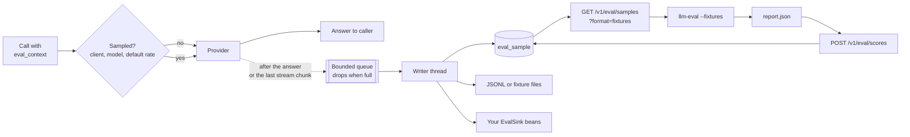

# Eval hooks

The gateway can keep a sample of real calls, with the context your app retrieved, and hand them
to [llm-eval-harness](https://github.com/rmkr-dev/llm-eval-harness) for faithfulness and
relevance scoring. Scores come back to the gateway and are averaged per model alias or client.
Nothing is sampled until you turn it on.



## Configuration

```yaml
gateway:
  eval:
    enabled: false        # off by default
    sample-rate: 0.01     # share of calls kept, 0 to 1
    models:               # per model alias
      rag-support: 0.2
    clients:              # per client, named as in auth.md
      search-api: 1.0
    tags: [prod]          # added to every sample and fixture
    sinks: [database]     # database, file, both, or [] with only EvalSink beans
    file:
      path: eval-samples
      format: jsonl       # jsonl or fixtures
    queue-capacity: 1000
    max-text-length: 32000   # longer prompts, context and answers are cut
    retention: 30d
    harness:              # what the fixtures export asks the harness to run
      faithfulness: { metrics: [token_overlap], threshold: 0.3 }
      relevance:    { metrics: [token_overlap], threshold: 0.1 }
```

The most specific rate wins: a client entry, then a model alias entry, then `sample-rate`.
The choice is made when the call arrives. Startup fails on an unknown sink, an unknown model
alias or a setup with nowhere to write. A harness metric the harness does not know only logs a
warning.

## Sending retrieved context

Add the passages your app retrieved as `eval_context`, a list of up to 100 strings:

```json
{
  "model": "rag-support",
  "messages": [
    { "role": "system", "content": "Answer only from the context." },
    { "role": "user", "content": "What is the refund window for annual plans?" }
  ],
  "eval_context": [
    "Refunds for annual plans are accepted within 30 days.",
    "Monthly plans are not refundable."
  ]
}
```

`eval_context` is never sent to a provider. Put the same passages in the prompt as you do
today. On calls that are not sampled it is dropped unread. Without it a sample still gets a
relevance check, but no faithfulness check.

## What is kept

| Field | Value |
|---|---|
| `id` | the call id, the same as in `/v1/calls/{id}` |
| `started_at`, `completed_at` | UTC |
| `client`, `model`, `provider`, `provider_model` | who called, which alias, who answered |
| `streamed` | whether the answer was streamed |
| `messages`, `question` | the prompt as the provider got it; `question` is the last user message |
| `context` | `eval_context` |
| `answer` | the answer as the provider gave it |
| `tags`, `pii_redactions` | config tags, redaction count |
| `scores` | `faithfulness`, `relevance`, `scored_at`, once scored |

Samples are written after the answer is complete: after the reply for a plain call, after the
last chunk for a streamed one. Failed calls, refused calls and streams that break are not kept.
Capture never slows or fails a call: when the queue is full the sample is dropped and counted.

With PII redaction on, the prompt, the context and the answer are kept as the provider saw
them, with `[EMAIL_1]` placeholders, never the original or restored values. The context gets the
same placeholders as the prompt, is not counted in `pii_redactions`, and under `block` it is
redacted rather than refused.

## Endpoints

All of them need the `Gateway.Reports` role (see [auth.md](auth.md)) and exist only while
eval hooks are on. Time filters work as in the reports API: `from`, `to`, `range`, `zone`,
plus `client`, `model` and `provider`.

| Endpoint | Does |
|---|---|
| `GET /v1/eval/samples?format=json` | samples, oldest first, `limit` up to 10000 (default 1000) |
| `GET /v1/eval/samples?format=jsonl` | one sample per line, `application/x-ndjson` |
| `GET /v1/eval/samples?format=fixtures` | `eval-fixtures.zip` for the harness |
| `GET /v1/eval/samples/{id}` | one sample |
| `POST /v1/eval/samples/{id}/scores` | `{"faithfulness": 0.8, "relevance": 0.6}` from any evaluator, 0 to 1, either or both |
| `POST /v1/eval/scores` | an llm-eval-harness JSON report |
| `GET /v1/eval/summary?group_by=model` | sample count, scored count and average score per model alias or `client` |

## Scoring with llm-eval-harness

The `fixtures` export is a fixtures directory the harness reads as is. Each sample becomes up
to two cases:

```text
gw-3f9c...-faithfulness/     only when the call sent eval_context
  input.txt                  the question
  expected.txt               the context passages, separated by blank lines
  actual.txt                 the answer
  meta.json                  metrics, thresholds, tags, call details
gw-3f9c...-relevance/
  input.txt                  the question
  expected.txt               the question
  actual.txt                 the answer
  meta.json
```

`meta.json` uses the harness fields (`id`, `description`, `metrics`, `thresholds`, `tags`) and
adds a `gateway` block with the call id, alias, provider and client. Tags are the check name,
`model:<alias>`, `client:<name>` and your configured tags, so `llm-eval --tag model:rag-support`
runs one alias.

```bash
curl -H "Authorization: Bearer $TOKEN" -o eval.zip \
  "$GATEWAY/v1/eval/samples?format=fixtures&range=1d"
unzip -q eval.zip -d eval-fixtures
llm-eval --fixtures eval-fixtures --out report.json   # exits 1 when any case fails
curl -H "Authorization: Bearer $TOKEN" -H "Content-Type: application/json" \
  --data @report.json "$GATEWAY/v1/eval/scores"
```

`POST /v1/eval/scores` takes the report unchanged. For each `<call id>-faithfulness` or
`<call id>-relevance` case it stores the mean of the case's metric scores. Skipped cases and
other case names are ignored. The response lists how many samples were updated and which call
ids are unknown, for example ones already purged.

The harness metrics are lexical, so `token_overlap` against the context is a rough grounding
signal, not a judgement. Change `harness.*.metrics` to any harness metric, or score with
another evaluator and post per sample.

## Sinks

| Sink | Writes |
|---|---|
| `database` | the `eval_sample` table (Flyway `V3`), used by the endpoints |
| `file` | `eval-samples-<UTC date>.jsonl`, or `fixtures-<UTC date>/` with `format: fixtures`, under `file.path` |
| `EvalSink` beans | anything else, such as a queue or object storage |

```java
@Bean
EvalSink evalQueue(QueueClient queue) {
    return samples -> samples.forEach(queue::send);
}
```

Sinks get batches from one background thread. One failing sink does not stop the others. The
file sink suits a single replica or a shared volume. Without `database` the endpoints have
nothing to read, so keep it on unless your own sink is the source of truth.

## Retention and metrics

Every `purge-interval` (1h) samples and dated files older than `retention` (30 days) are
deleted.

With Micrometer on the classpath, `gateway.eval.samples{result=sampled|dropped}` and
`gateway.eval.sink.writes{sink,result=ok|failed}` are counted.

## Why off by default

Eval samples are the only place the gateway stores prompts and answers. Turn it on with a
small rate, with PII redaction on for anything that faces external providers, and keep
`retention` short.
