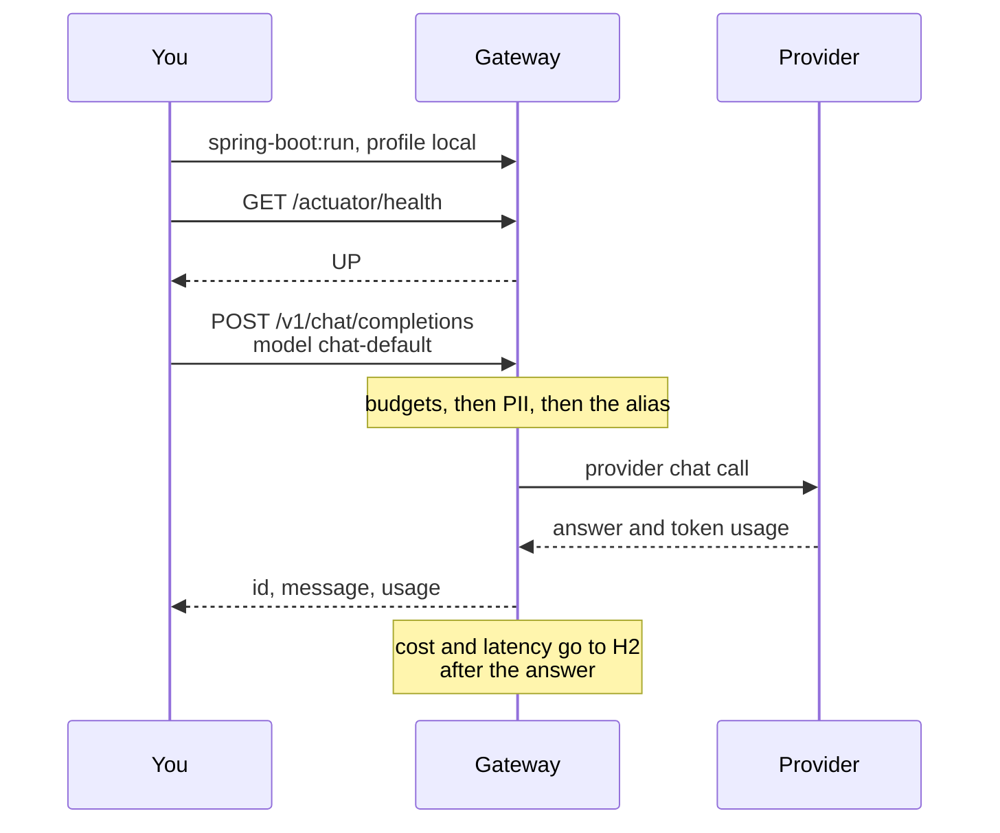

# Getting started

From a checkout to a local chat call, with auth off. Entra, providers, routing, tracking
and AKS each have their own page; this one only gets the process running.



## What you need

- Java 21 and Maven.
- A token that can read GitHub Packages, for `spring-security-jwt-starter`.
- One model provider, or a local OpenAI-compatible server such as Ollama.

## Maven and GitHub Packages

The starter is published to GitHub Packages, and that registry asks for a token even when
the package is public. The repository is already in the pom, under the server id
`github-entra-security`. Add that server to `~/.m2/settings.xml`:

```xml
<server>
    <id>github-entra-security</id>
    <username>${env.GITHUB_ACTOR}</username>
    <password>${env.GITHUB_TOKEN}</password>
</server>
```

Locally, `GITHUB_ACTOR` is your GitHub login and `GITHUB_TOKEN` is a personal access token
with `read:packages`. CI and the Docker build use the same server id. The starter's notes
on the token are
[here](https://github.com/rmkr-dev/spring-security-jwt-starter/blob/main/docs/releasing.md#installing).

## Where config lives

| Source | What it holds |
|---|---|
| `src/main/resources/application.yml` | Shipped defaults. Providers and aliases are empty. Tracking, reports and the dashboard are on. PII is off, eval is off, auth is on. |
| `src/main/resources/application-local.yml` | The `local` profile: `entra.security.enabled=false`, and nothing else. |
| `config/application-local.yml`, next to `pom.xml` | Your providers, aliases and prices. Maven starts in the project directory, so Spring reads this file when the `local` profile is on. It is not part of the repo. |
| Environment variables | Secrets and deployment settings: `OPENROUTER_API_KEY`, `SPRING_DATASOURCE_URL`, `SPRING_DATASOURCE_USERNAME`, `SPRING_DATASOURCE_PASSWORD`, `ENTRA_SECURITY_TENANTID`, `ENTRA_SECURITY_CLIENTID`. |
| AKS | ConfigMap file `/config/gateway.yml` and Key Vault files under `/mnt/secrets`. See [deployment-aks.md](deployment-aks.md). |

Keep keys in the environment. The yaml only names the placeholder. A `java -jar` start reads
`config/` from that process's working directory, not from the git checkout.

## A provider and an alias

Shipped config has no providers, so a chat call for `chat-default` is a 404 until you add
one. Create `config/application-local.yml`:

```yaml
gateway:
  providers:
    openrouter:
      base-url: https://openrouter.ai/api/v1
      api-key: ${OPENROUTER_API_KEY}
  models:
    chat-default:
      targets:
        - provider: openrouter
          model: meta-llama/llama-3.1-70b-instruct
```

A local server needs no key. The alias can point at it instead:

```yaml
gateway:
  providers:
    local:
      base-url: http://localhost:11434/v1
  models:
    chat-default:
      targets:
        - provider: local
          model: llama3.1
```

Anthropic, Gemini, Bedrock and the other OpenAI-compatible services are in
[providers.md](providers.md). How an alias retries and falls back is in
[routing.md](routing.md).

## Run the local profile

```bash
export GITHUB_ACTOR=<github-login>
export GITHUB_TOKEN=<token with read:packages>
export OPENROUTER_API_KEY=<key>    # omit this for the local server above
mvn spring-boot:run -Dspring-boot.run.profiles=local
```

The profile turns Entra off, opens every endpoint and names callers from the
`X-Gateway-Client` header. The process logs a warning at startup. Do not use it on a shared
network. Roles, client names and running with Entra are in
[auth.md](auth.md#local-development-without-entra).

```bash
curl -s localhost:8080/actuator/health
curl -s localhost:8080/v1/models
```

`/actuator/health` is public even with auth on. `/v1/models` lists aliases and the provider
order for each, without keys or URLs. With the file above, `chat-default` is in the list.
Without that file the list is empty.

## First chat call

```bash
curl -s localhost:8080/v1/chat/completions \
  -H 'Content-Type: application/json' \
  -H 'X-Gateway-Client: local-dev' \
  -d '{
    "model": "chat-default",
    "messages": [{"role": "user", "content": "What is retrieval augmented generation?"}],
    "max_tokens": 200
  }'
```

```json
{
  "id": "gw-6f1c...",
  "model": "chat-default",
  "provider": "openrouter",
  "provider_model": "meta-llama/llama-3.1-70b-instruct",
  "message": {"role": "assistant", "content": "..."},
  "finish_reason": "stop",
  "usage": {"prompt_tokens": 14, "completion_tokens": 120, "total_tokens": 134}
}
```

`X-Gateway-Calls` counts the provider calls, including fallbacks. Errors come back as
`application/problem+json`. Add `"stream": true` for server-sent events; the chunk format is
in [providers.md](providers.md#streaming).

The call is stored in the in-memory H2 database after the answer is sent, with a cost when
a price matches. `GET /v1/calls/{id}` reads it back once the writer has flushed, within the
flush interval (a second by default). Prices and Postgres are in [tracking.md](tracking.md).
Reports and the dashboard are on. With auth off they are open at `/v1/reports/summary`
and `/dashboard`; with auth on they need `Gateway.Reports`. See [reports.md](reports.md).

## Where to go next

| Page | What it adds |
|---|---|
| [auth.md](auth.md) | Entra, the two app roles, and leaving the local profile |
| [providers.md](providers.md) | Adapters, streaming, and Bedrock signing |
| [routing.md](routing.md) | Retries, fallback, and `fallback-on-bad-request` |
| [tracking.md](tracking.md) | Prices, storage, and call lookup |
| [deployment-aks.md](deployment-aks.md) | Kustomize on AKS |
| [architecture.md](architecture.md) | The same call, as one picture |
| [README.md](README.md) | The rest of the docs |
