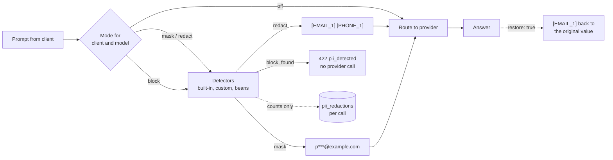

# PII redaction

The gateway can find personal data in prompts and replace, mask or refuse it before any
provider sees it. Detection runs on every prompt message, plain and streamed, after the budget
and rate-limit checks and before routing. Nothing is redacted until you turn it on.



## Configuration

```yaml
gateway:
  pii:
    mode: "off"            # default for every call: off, mask, redact or block
    models:                # per model alias
      chat-external: redact
    clients:               # per client, named as in auth.md
      billing-api: block
    detectors: []          # built-in ids to use; empty means all of them
    custom:
      employee-id:
        pattern: "EMP-\\d{6}"
        label: EMPLOYEE    # placeholder prefix, defaults to the id in capitals
    restore: false         # put originals back into answers (redact mode only)
    scrub-logs: true       # scrub provider error details before they are logged
```

When a client and a model alias both have an entry, the stricter one wins
(`block` > `redact` > `mask` > `off`). Quote `"off"` in YAML.

| Mode | Provider sees | Caller gets |
|---|---|---|
| `off` | the prompt as sent | the answer |
| `mask` | `p***@example.com`, `**** **** **** 1111` | the answer |
| `redact` | `[EMAIL_1]`, `[CARD_1]`; the same value always gets the same placeholder in a call | the answer, with originals put back if `restore` is on |
| `block` | nothing | `422` problem when anything is found |

## Detectors

| Id | Placeholder | Finds | Checked with |
|---|---|---|---|
| `credit-card` | `CARD` | 13 to 19 digits, spaces or dashes allowed | Luhn |
| `iban` | `IBAN` | compact or grouped IBANs | mod 97 |
| `in-aadhaar` | `AADHAAR` | 12 digits, grouped or not | Verhoeff |
| `us-ssn` | `SSN` | `123-45-6789` | invalid area and group numbers skipped |
| `in-pan` | `PAN` | `ABCPE1234F` | holder type letter |
| `email` | `EMAIL` | addresses with a dotted domain | |
| `ip-address` | `IP` | IPv4 and IPv6 | octet ranges, group count |
| `phone` | `PHONE` | international `+..`, Indian mobiles, US formats | 8 to 15 digits |

Every pattern is compiled once and anchored on word boundaries, so order numbers, SKUs and
version strings are not taken for personal data. When matches overlap, the first detector in
the order custom, beans, built-ins (as listed) keeps the span. A full set of detectors on a
2 KB prompt adds well under a millisecond.

Startup fails on an unknown detector id, a duplicate id, an unknown model alias, a pattern that
does not compile or matches empty text, or a label that is not `A-Z`, digits and `_`.

## Your own detectors

Simple kinds go in `custom` as above. For anything that needs code, such as a lookup or a
checksum, add a `PiiDetector` bean. It is picked up next to the built-in ones and can be
listed in `detectors`:

```java
@Bean
PiiDetector customerNumber() {
    return new PatternDetector("customer-number", "CUSTOMER",
            Pattern.compile("(?<![\\w-])CU\\d{8}(?![\\w-])"), CustomerNumbers::valid, null);
}
```

Detectors must be thread-safe and fast. They run on every prompt message.

## What callers see

Redacted or masked calls carry the counts, never the values:

```http
X-Gateway-Pii: email=1,phone=1
```

A blocked call is refused before any provider is asked:

```json
{
  "status": 422,
  "title": "Personal data not allowed",
  "detail": "The request contains personal data (email, phone) and the policy for this caller blocks it",
  "code": "pii_detected",
  "detected": { "email": 1, "phone": 1 }
}
```

## Restoring placeholders

With `restore: true` and mode `redact`, placeholders in the answer are swapped back for the
values they replaced, in plain and streamed answers. A placeholder split across stream chunks
is held back until it is complete. Only placeholders made for this call are replaced, and the
originals live in memory for the length of the call only. Leave it off when the answer goes
somewhere the original values should not.

## Logs and storage

Prompts and answers are never stored or logged by the gateway. What is stored per call is the
number of redactions, in the `pii_redactions` column, shown by `GET /v1/calls/{id}`. Blocked
calls are stored with error `pii_blocked`. Provider error details, which can echo the prompt,
are scrubbed (`[EMAIL]`) before they reach the debug log whatever the mode, unless
`scrub-logs` is turned off.

Request `metadata` is not sent to providers or stored, so it is not scanned.

## Why off by default

Like budgets and the bad-request fallback, redaction changes what providers receive, so it
waits until you choose a mode. Log scrubbing needs no choice and is on from the start. For a
gateway that faces external providers, `mode: redact` is the usual setting.
