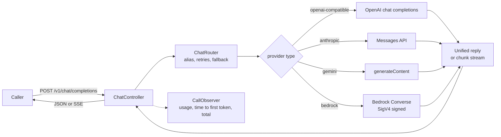
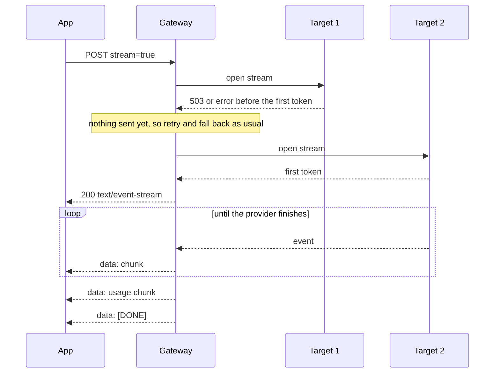
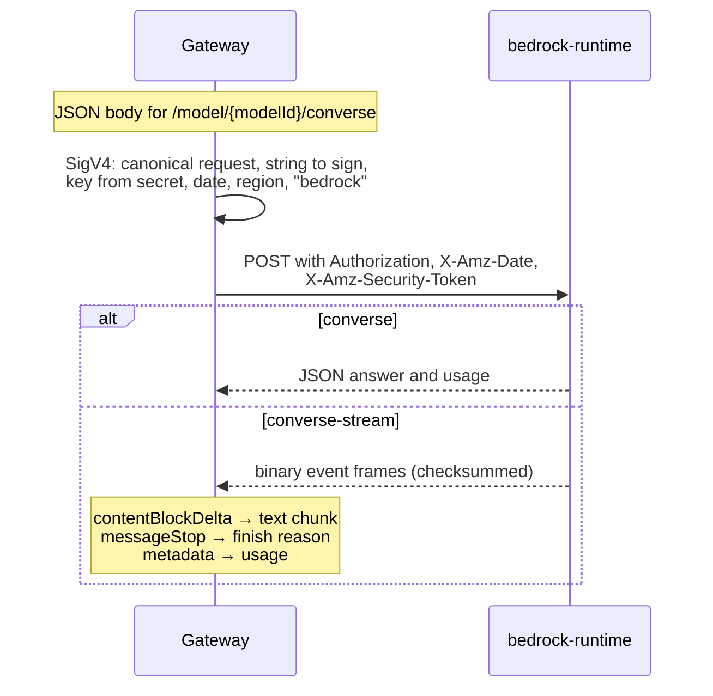

# Providers and streaming

Every provider plugs into one SPI. The `type` of a provider entry picks the adapter, so adding
another OpenAI-compatible service, or another Anthropic, Gemini or Bedrock account, is
configuration only.



| `type` | Wire API | Key header (default) | Path (default) |
|---|---|---|---|
| `openai-compatible` | OpenAI chat completions | `Authorization: Bearer <key>` | `/chat/completions` |
| `anthropic` | Anthropic Messages | `x-api-key: <key>`, plus `anthropic-version: 2023-06-01` | `/v1/messages` |
| `gemini` | Gemini `generateContent` | `x-goog-api-key: <key>` | `/models` + `/{model}:generateContent` |
| `bedrock` | Bedrock Converse | SigV4 from `aws`, or `Authorization: Bearer <api-key>` | `/model` + `/{modelId}/converse` |

`api-key-header`, `api-key-prefix`, `chat-path` and `headers` override any default, for example
to go through a corporate proxy or to pin another `anthropic-version`.

## Example configuration

```yaml
gateway:
  providers:
    openrouter:                      # also Together, Groq, Mistral, Modal, vLLM
      base-url: https://openrouter.ai/api/v1
      api-key: ${OPENROUTER_API_KEY}
    together:
      base-url: https://api.together.xyz/v1
      api-key: ${TOGETHER_API_KEY}
    groq:
      base-url: https://api.groq.com/openai/v1
      api-key: ${GROQ_API_KEY}
    ollama:                          # local, no key
      base-url: http://ollama:11434/v1
    anthropic:
      type: anthropic
      base-url: https://api.anthropic.com
      api-key: ${ANTHROPIC_API_KEY}
      default-max-tokens: 2048       # used when the caller sends no max_tokens
    gemini:
      type: gemini
      base-url: https://generativelanguage.googleapis.com/v1beta
      api-key: ${GEMINI_API_KEY}
    bedrock:
      type: bedrock                  # base-url defaults to bedrock-runtime.<region>.amazonaws.com
      aws:
        region: us-east-1
        access-key-id: ${AWS_ACCESS_KEY_ID}
        secret-access-key: ${AWS_SECRET_ACCESS_KEY}
        session-token: ${AWS_SESSION_TOKEN:}   # only for temporary credentials
  models:
    chat-default:
      targets:
        - provider: anthropic
          model: claude-sonnet-4-5
        - provider: bedrock
          model: anthropic.claude-3-5-sonnet-20240620-v1:0   # model id, inference profile id or ARN
        - provider: gemini
          model: gemini-2.5-flash
        - provider: openrouter
          model: meta-llama/llama-3.1-70b-instruct
```

## How native APIs are mapped

| Unified | Anthropic | Gemini | Bedrock Converse |
|---|---|---|---|
| `system` / `developer` messages | joined into `system` | `systemInstruction` | `system` text blocks |
| `assistant` role | `assistant` | `model` | `assistant` |
| `max_tokens` | `max_tokens`, always sent: caller value, else `default-max-tokens`, else 4096 | `generationConfig.maxOutputTokens` when set | `inferenceConfig.maxTokens` when set |
| `temperature` | `temperature` | `generationConfig.temperature` | `inferenceConfig.temperature` |
| `prompt_tokens` | `input_tokens` + cache reads + cache writes | `promptTokenCount` | `inputTokens` + cache reads + cache writes |
| `completion_tokens` | `output_tokens` | `candidatesTokenCount` + `thoughtsTokenCount` | `outputTokens` |
| `cache_read_tokens` / `cache_write_tokens` | `cache_read_input_tokens` / `cache_creation_input_tokens` | `cachedContentTokenCount` / none | `cacheReadInputTokens` / `cacheWriteInputTokens` |
| `finish_reason` | `end_turn` → `stop`, `max_tokens` → `length`, `tool_use` → `tool_calls`, `refusal` → `content_filter` | `STOP` → `stop`, `MAX_TOKENS` → `length`, safety reasons → `content_filter` | `end_turn` → `stop`, `max_tokens` → `length`, `tool_use` → `tool_calls`, `guardrail_intervened` → `content_filter` |

Other roles, such as `tool`, are rejected with 400 before any call to a native provider.
Gemini thought summaries and Bedrock reasoning blocks are left out of the answer. OpenAI-compatible providers report
`cache_read_tokens` from `prompt_tokens_details.cached_tokens`.

## Streaming

Send `"stream": true` and the answer comes back as `text/event-stream` in the OpenAI
`chat.completion.chunk` format, whatever the provider, so OpenAI SDKs read it unchanged.



```text
data: {"id":"gw-...","object":"chat.completion.chunk","created":1761400000,"model":"chat-default","provider":"anthropic","provider_model":"claude-sonnet-4-5","choices":[{"index":0,"delta":{"role":"assistant","content":"Retrieval"},"finish_reason":null}]}

data: {"id":"gw-...", ... "choices":[{"index":0,"delta":{},"finish_reason":"stop"}]}

data: {"id":"gw-...", ... "choices":[],"usage":{"prompt_tokens":14,"completion_tokens":120,"total_tokens":134}}

data: [DONE]
```

- Routing, retries and fallback apply until the first token. A target only wins once it has
  produced content, so a stream that fails before that still falls back.
- Errors before the first token are ordinary `application/problem+json` responses (404, 400,
  502), exactly as without streaming.
- After the first token the gateway is committed. An upstream failure ends the stream with one
  `data: {"error":{"type":"upstream_error","code":"transient","provider":"..."}}` event and no
  `[DONE]`, so a cut-off answer cannot be mistaken for a complete one.
- OpenAI-compatible calls ask for usage with `stream_options.include_usage`; Anthropic,
  Gemini and Bedrock report it in their own events. The usage chunk is sent whenever the provider gave
  counts.
- `read-timeout` covers the wait for the response headers and then the longest silence allowed
  between two events, so long answers are never cut off by a total timeout.
- Streams are written on the request's virtual thread, so long answers hold no platform thread.

## Call outcomes

Every finished call, plain or streamed, successful or not, produces a `CallOutcome`: alias,
provider and model, failed attempts, usage, finish reason, time to first token and total time.
It holds no prompt or answer text. Beans implementing `CallObserver` receive it; built-in cost
and latency storage (milestone 4) is one such observer.

## Bedrock

Bedrock calls are signed with AWS Signature Version 4 by the gateway itself, without the AWS
SDK. The signer is tested against the official AWS SigV4 test suite.



- Credentials come from `aws.access-key-id`, `aws.secret-access-key` and the optional
  `aws.session-token`. Blank keys fall back to `AWS_ACCESS_KEY_ID`, `AWS_SECRET_ACCESS_KEY`
  and `AWS_SESSION_TOKEN`. Missing region or keys fail startup. Keys never appear in logs,
  errors or `toString`.
- A Bedrock API key in `api-key` is sent as `Authorization: Bearer` instead, with no signing.
- Model ids, inference profile ids and ARNs all work as `model`; `:` and `/` are encoded.
- `base-url` can point at a VPC endpoint; `aws.region` still sets the signing region.
- Errors follow the usual [routing rules](routing.md): `ValidationException` (400, 413) is a
  request failure, 408, 429 and 5xx are retried, 403, 404 and 424 fall back at once. In a
  stream, `throttlingException`, `serviceUnavailableException`, `internalServerException` and
  `modelStreamErrorException` are transient, and `validationException` counts as a 400.
- Credentials are static: rotate them in the secret store. Instance roles and web identity
  are not read.
