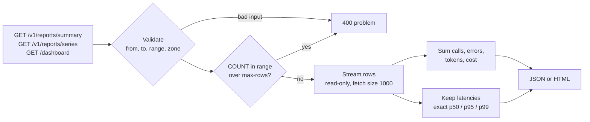
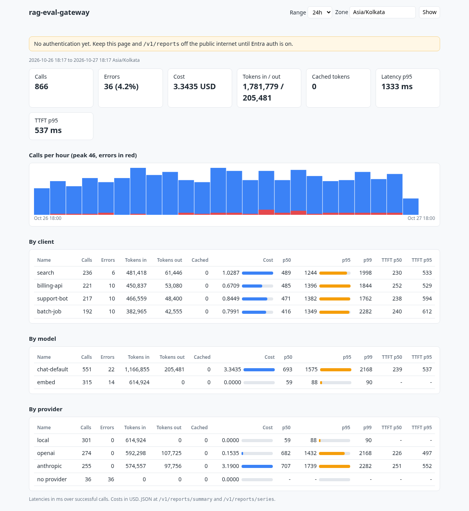

# Reports and dashboard

Reports read the `gateway_call` table that [tracking](tracking.md) fills. There is a JSON API
for scripts and a server-rendered dashboard for people. Neither needs anything besides the
gateway and its database.

Both are on by default and need the `GATEWAY_REPORTS` role (Entra app role
`Gateway.Reports`); see [auth.md](auth.md). Turn either off with
`gateway.reports.enabled=false` or `gateway.reports.dashboard.enabled=false`.



## Summary

Calls grouped by `client`, `model` (the alias callers asked for) or `provider`, busiest first.

```bash
curl 'localhost:8080/v1/reports/summary?group_by=client&range=7d'
```

```json
{
  "from": "2026-10-20T12:00:00Z",
  "to": "2026-10-27T12:00:00Z",
  "zone": "UTC",
  "group_by": "client",
  "currency": "USD",
  "totals": { "calls": 866, "errors": 36, "...": "same fields as each group" },
  "groups": [
    {
      "key": "billing-api",
      "calls": 221,
      "errors": 10,
      "prompt_tokens": 450837,
      "completion_tokens": 53080,
      "cache_read_tokens": 0,
      "cache_write_tokens": 0,
      "cost": 0.6709,
      "unpriced_calls": 0,
      "total_ms": { "p50": 485, "p95": 1396, "p99": 1844 },
      "ttft_ms": { "p50": 252, "p95": 529, "p99": 610 }
    }
  ]
}
```

Failed calls that no provider answered have `"key": null` when grouped by provider.

## Series

The same fields per `hour` or `day` bucket, oldest first, empty buckets included, which is
what a chart needs.

```bash
curl 'localhost:8080/v1/reports/series?bucket=day&range=30d&zone=Asia/Kolkata&model=chat-default'
```

```json
{
  "bucket": "day",
  "zone": "Asia/Kolkata",
  "points": [
    { "start": "2026-10-26T00:00:00+05:30", "calls": 412, "cost": 1.92, "...": "..." }
  ]
}
```

Without `bucket`, ranges up to two days use hours and longer ones use days. The first bucket
starts at the hour or midnight before `from`. A series has at most 1000 buckets.

## Parameters

| Parameter | Default | Notes |
|---|---|---|
| `from` | `to` minus `range` | ISO-8601 with offset (`2026-10-27T09:00:00Z`), local time or date read in `zone` |
| `to` | now | Same formats; calls at exactly `to` are left out |
| `range` | `gateway.reports.default-range` | `6h`, `7d`; use it or `from`, not both |
| `zone` | `UTC` | Day buckets and plain dates, for example `Asia/Kolkata` |
| `client`, `model`, `provider` | none | Only calls with this value |
| `group_by` | `model` | Summary only: `client`, `model`, `provider` |
| `bucket` | by range | Series only: `hour`, `day` |

Bad input is a `400` `application/problem+json` with a `detail` that says what to fix: an
unknown `group_by` or `bucket`, an unparseable time or zone, `from` not before `to`, a range
longer than `max-range`, or more calls than `max-rows`.

## How the numbers are worked out

- **Cost** sums calls priced in `gateway.pricing.currency`. `unpriced_calls` counts calls that
  used tokens but had no price (or were priced in another currency before a currency change).
- **Latency** percentiles cover successful calls only, so a failed fallback chain does not
  skew them. `ttft_ms` is `null` when no call in the group reports a first token.
- **Percentiles are exact**, nearest-rank: each is a time a real call took. Postgres has
  `percentile_cont` but H2 does not, so rather than two SQL dialects the gateway streams the
  range once and computes them in Java. `max-rows` bounds that scan; Postgres reads it through
  a cursor, so memory stays at a few bytes per call.

## Dashboard

`/dashboard` shows totals, calls per hour or day with errors in red, and cost and latency by
client, model and provider for 1h, 6h, 24h, 7d or 30d, in any time zone. It is one Thymeleaf
page with inline CSS and SVG: no scripts, no build step, nothing from a CDN.



## Configuration

| Property | Default | Purpose |
|---|---|---|
| `gateway.reports.enabled` | `false` | Serve `/v1/reports/*` (and allow the dashboard) |
| `gateway.reports.dashboard.enabled` | `false` | Serve `/dashboard`; needs `gateway.reports.enabled` too |
| `gateway.reports.default-range` | `24h` | Range when no `from` or `range` is given |
| `gateway.reports.max-range` | `31d` | Longest range one report may cover |
| `gateway.reports.max-rows` | `500000` | Most calls one report may read |

Both need `gateway.tracking.enabled`. With tracking off, neither endpoint exists. The
dashboard and the `zone` parameter default to UTC.
