# Roadmap to v1.0.0

```mermaid
flowchart LR
    A[1 Skeleton and CI] --> B[2 Provider SPI<br/>OpenAI-compatible adapter<br/>routing and fallback]
    B --> C[3 Native adapters<br/>Anthropic, Gemini<br/>SSE streaming]
    C --> D[4 Cost and latency<br/>tracking in Postgres]
    D --> E[5 Reports API<br/>and dashboard]
    E --> F[6 Entra auth]
    F --> G[7 Budgets and<br/>rate limits]
    G --> H[8 PII redaction]
    H --> I[9 Eval hooks]
    I --> J[10 AKS with Kustomize]
    J --> K[11 Docs]
    K --> L[12 v1.0.0]
```

| # | Milestone | Status |
|---|-----------|--------|
| 1 | Skeleton, unified API contract, provider and alias config, CI, CodeQL, Docker image | Done |
| 2 | Provider SPI, generic OpenAI-compatible adapter (any base URL, key header, model), config-driven routing, fallback chains, retries | Done |
| 3 | Native Anthropic and Gemini adapters, server-sent event streaming for every adapter, call outcomes with time to first token | Done |
| 4 | Per-call cost (config price table) and latency (time to first token, total) stored in Postgres, H2 for dev, Flyway | Done |
| 5 | Summary REST endpoints by client, model, provider and time range with p50/p95/p99, Thymeleaf dashboard | Next |
| 6 | Entra auth via `spring-security-jwt-starter` 1.0.0 | Planned |
| 7 | Per-client token budgets and rate limits enforced from stored usage | Planned |
| 8 | PII redaction for prompts and logs | Planned |
| 9 | Faithfulness and relevance sampling hooks compatible with `llm-eval-harness` | Planned |
| 10 | Kustomize base with dev and prod overlays: workload identity, Key Vault CSI, HPA, PDB, NetworkPolicy, probes, preflight script, deploy workflow | Planned |
| 11 | Diagram-first docs | Planned |
| 12 | Release v1.0.0 | Planned |

AWS Bedrock moved out of milestone 3: it needs SigV4 signing and the AWS SDK, so it gets its
own change after milestone 5, using the Converse API behind the same SPI. Until then a
`bedrock` provider is skipped by fallback.

Routing by client and by cost builds on the alias routing from milestone 2 once callers are
identified (milestone 6) and costs are stored (milestone 4).

Micrometer metrics stay optional. The built-in store is the main path for cost and latency.
