# Roadmap to v1.0.0

```mermaid
flowchart LR
    A[1 Skeleton and CI] --> B[2 Provider SPI<br/>OpenAI-compatible adapter<br/>routing and fallback]
    B --> C[3 Native adapters<br/>Anthropic, Gemini<br/>SSE streaming]
    C --> D[4 Cost and latency<br/>tracking in Postgres]
    D --> E[5 Reports API<br/>and dashboard]
    E --> BR[AWS Bedrock<br/>adapter]
    BR --> F[6 Entra auth]
    F --> G[7 Budgets and<br/>rate limits]
    G --> H[8 PII redaction]
    H --> I[9 Eval hooks]
    I --> J[10 AKS with Kustomize]
    J --> K[11 Diagram-first<br/>docs]
    K --> L[12 v1.0.0]
```

| # | Milestone | Status |
|---|-----------|--------|
| 1 | Skeleton, unified API contract, provider and alias config, CI, CodeQL, Docker image | Done |
| 2 | Provider SPI, generic OpenAI-compatible adapter (any base URL, key header, model), config-driven routing, fallback chains, retries | Done |
| 3 | Native Anthropic and Gemini adapters, server-sent event streaming for every adapter, call outcomes with time to first token | Done |
| 4 | Per-call cost (config price table) and latency (time to first token, total) stored in Postgres, H2 for dev, Flyway | Done |
| 5 | Summary REST endpoints by client, model, provider and time range with p50/p95/p99, Thymeleaf dashboard | Done |
| 6 | Entra auth via `spring-security-jwt-starter` 1.0.0: `Gateway.Call` and `Gateway.Reports` roles, client from the token, reports and dashboard on by default | Done |
| 7 | Per-client token and cost budgets from stored usage, request and token rate limits, `429` with `Retry-After` | Done |
| 8 | PII redaction for prompts, streams and logs: mask, redact, block, per client and model, custom detectors | Done |
| 9 | Faithfulness and relevance sampling hooks compatible with `llm-eval-harness` | Done |
| 10 | Kustomize base with dev and prod overlays: workload identity, Key Vault CSI, HPA, PDB, NetworkPolicy, probes, preflight script, deploy workflow | Done |
| 11 | Diagram-first docs: getting started, architecture overview, docs index | Done |
| 12 | Release v1.0.0 | Planned |

After milestone 5, and before Entra auth:

| Item | Status |
|---|---|
| Reports API and dashboard off by default until auth protects them | Done |
| Per-alias `fallback-on-bad-request` switch, off by default | Done |
| AWS Bedrock adapter: Converse and ConverseStream, hand-written SigV4 signing, no AWS SDK | Done |

AWS Bedrock moved out of milestone 3 and shipped before milestone 6, behind the same SPI. It
signs requests itself instead of pulling in the AWS SDK. See
[providers.md](providers.md#bedrock).

Routing by client and by cost builds on the alias routing from milestone 2, now that callers
are identified from their tokens (milestone 6) and costs are stored (milestone 4). See
[auth.md](auth.md). Budgets and rate limits (milestone 7) use the same client names and stored
costs; see [budgets.md](budgets.md). PII redaction (milestone 8) uses the same client names
and model aliases to pick a mode; see [pii-redaction.md](pii-redaction.md). Eval hooks
(milestone 9) sample calls by the same names, keep prompts only after redaction and export
fixtures that `llm-eval-harness` runs as is; see [eval-hooks.md](eval-hooks.md).
AKS deployment (milestone 10) is plain Kustomize, with no Helm chart, and reads every secret
from Key Vault through workload identity; see [deployment-aks.md](deployment-aks.md). The
docs pass is [getting-started.md](getting-started.md), [architecture.md](architecture.md)
and the [index](README.md). What is left is the v1.0.0 release.

Micrometer metrics stay optional. The built-in store is the main path for cost and latency.
