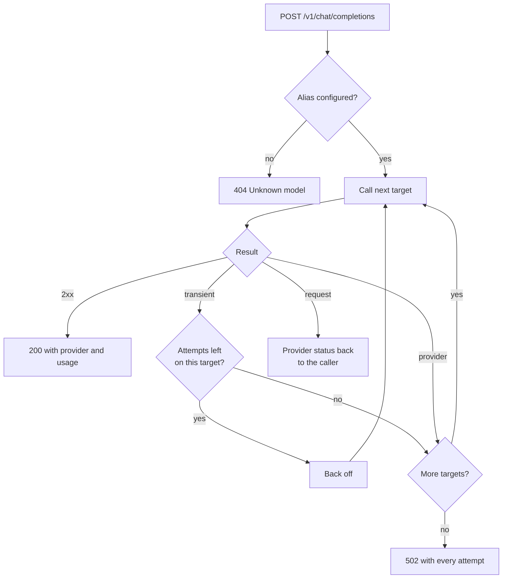

# Routing, retries and fallback

A caller asks for a model alias. The gateway tries the alias's targets in order until one
answers.



| Failure | Examples | What happens |
|---|---|---|
| Transient | timeout, connection error, 408, 425, 429, 5xx | Retry the same target, then fall back |
| Provider | 401, 403, 404, response without choices, stream that ends before any content, type with no adapter yet | Fall back at once |
| Request | 400, 413, 422 | Stop and return the provider's status and message (400 can [fall back](#falling-back-on-400)) |

## Falling back on 400

Providers do not all accept the same parameters, so a request one rejects with 400 may work on
the next. An alias can opt in to treating a 400 like a provider failure:

```yaml
gateway:
  models:
    chat-default:
      fallback-on-bad-request: true   # default false
      targets:
        - provider: openrouter
          model: meta-llama/llama-3.1-70b-instruct
        - provider: anthropic
          model: claude-sonnet-4-5
```

| `fallback-on-bad-request` | 400 from a target |
|---|---|
| `false` (default) | Returned to the caller, no more targets tried |
| `true` | Next target tried at once, without retrying; a 400 from the last target is returned to the caller |

413 and 422 always go back to the caller. The 400 is listed in `attempts` and counted in
`X-Gateway-Calls` like any other failed call. When streaming, the switch applies only before
the first token, like every other fallback.

## Backoff

Wait before retry *n* = `initial-backoff × multiplier^(n-1)`, capped at `max-backoff`, then
shortened by up to `jitter` (a fraction) so clients do not retry in lockstep. A `Retry-After`
header in seconds replaces the computed wait, still capped at `max-backoff`.

```yaml
gateway:
  retry:
    max-attempts: 2        # tries per target, including the first
    initial-backoff: 200ms
    max-backoff: 2s
    multiplier: 2.0
    jitter: 0.2
```

## What callers see

- `X-Gateway-Calls` on success: provider calls made, including the one that answered.
- On 502, `attempts` lists provider id, model, try number, failure kind and status for each
  failed call. Base URLs, keys and prompts are never included.

## Streaming

The same rules apply to `"stream": true` until the first token reaches the gateway. After
that the answer is committed to one target, and an upstream failure ends the stream with an
error event instead of falling back. See [providers.md](providers.md#streaming).
