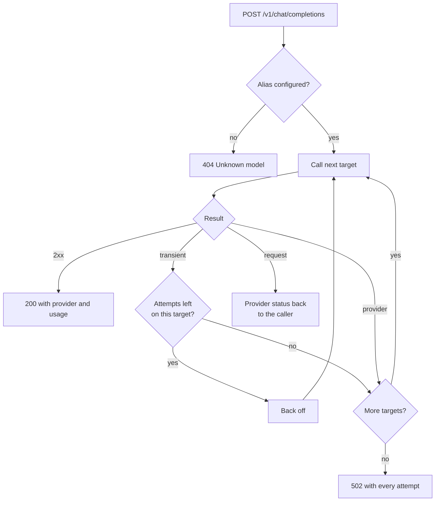

# Routing, retries and fallback

A caller asks for a model alias. The gateway tries the alias's targets in order until one
answers.



| Failure | Examples | What happens |
|---|---|---|
| Transient | timeout, connection error, 408, 425, 429, 5xx | Retry the same target, then fall back |
| Provider | 401, 403, 404, response without choices, type with no adapter yet | Fall back at once |
| Request | 400, 413, 422 | Stop and return the provider's status and message |

## Backoff

Wait before retry *n* = `initial-backoff × multiplier^(n-1)`, capped at `max-backoff`, then
shortened by up to `jitter` (a fraction) so clients do not retry in lockstep. A `Retry-After`
header in seconds replaces the computed wait, still capped at `max-backoff`.

```yaml
gateway:
  retry:
    max-attempts: 2        # tries per target, including the first
    initial-backoff: 200ms
    max-backoff: 2s
    multiplier: 2.0
    jitter: 0.2
```

## What callers see

- `X-Gateway-Calls` on success: provider calls made, including the one that answered.
- On 502, `attempts` lists provider id, model, try number, failure kind and status for each
  failed call. Base URLs, keys and prompts are never included.
