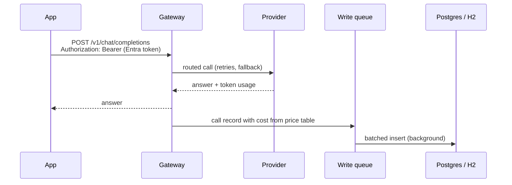
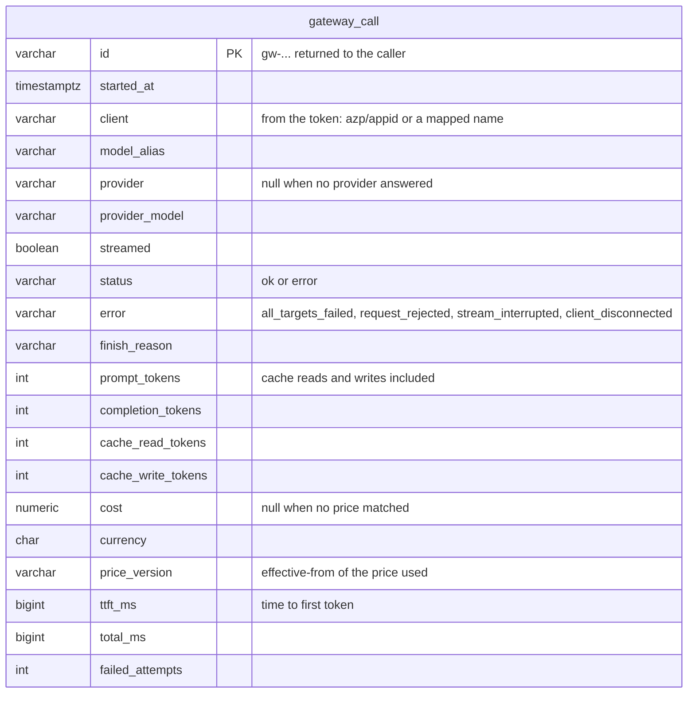
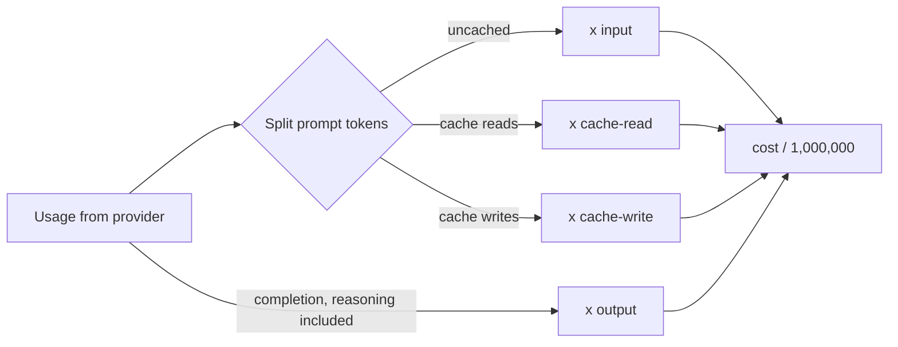

# Cost and latency tracking

Every call through the gateway is priced and stored in the gateway's own database. No
external metrics service is needed. Prompt and answer text is never stored.



The answer goes back before anything touches the database. Records wait in a bounded
in-memory queue and a background writer inserts them in batches. If the queue fills up or the
database is down, records are dropped and counted, and callers are never slowed down.
Pending records are written on graceful shutdown.

## What is stored



Indexes cover a time range alone and a time range by client, alias or provider, which is what
the [reports](reports.md) query.

## Prices

Prices are per million tokens and live in configuration, so a price change is a config change.

```yaml
gateway:
  pricing:
    currency: USD
    prices:
      - provider: openai
        model: gpt-4o-mini
        input: 0.15
        output: 0.60
        cache-read: 0.075
      - provider: openai          # new price from 1 Nov, old calls keep the old cost
        model: gpt-4o-mini
        input: 0.12
        output: 0.48
        effective-from: 2026-11-01
      - provider: anthropic
        model: claude-sonnet-4-5
        input: 3
        output: 15
        cache-read: 0.30
        cache-write: 3.75
      - provider: local           # any model on this provider
        model: "*"
        input: 0
        output: 0
```



- An exact model entry wins over `*` on the same provider.
- Among matching entries the latest `effective-from` not after the call's UTC day is used.
- `cache-read` and `cache-write` default to `input`.
- A call with no matching price is still stored, with `cost` and `currency` empty.
- Startup fails if a price names a provider that is not configured.

## Database

Local runs use in-memory H2 with no setup. Anywhere the data matters, point the gateway at
Postgres and Flyway creates the schema on startup:

```bash
export SPRING_DATASOURCE_URL=jdbc:postgresql://db:5432/gateway
export SPRING_DATASOURCE_USERNAME=gateway
export SPRING_DATASOURCE_PASSWORD=...   # from Key Vault in AKS
```

| Property | Default | Purpose |
|---|---|---|
| `gateway.tracking.enabled` | `true` | Record calls at all |
| `gateway.tracking.queue-capacity` | `10000` | Records held in memory before new ones are dropped |
| `gateway.tracking.batch-size` | `200` | Most records per insert |
| `gateway.tracking.flush-interval` | `1s` | Longest a record waits before it is written |
| `gateway.tracking.retention` | `90d` | Age after which calls are deleted, `0` keeps them forever |
| `gateway.tracking.purge-interval` | `1h` | How often old calls are deleted |

## Look up a call

The `id` in every chat response (and in every streamed chunk) finds its stored record:

```bash
curl localhost:8080/v1/calls/gw-6f1c...
```

```json
{
  "id": "gw-6f1c...",
  "started_at": "2026-10-26T12:30:04.112Z",
  "client": "billing-api",
  "model": "chat-default",
  "provider": "openai",
  "provider_model": "gpt-4o-mini",
  "streamed": false,
  "status": "ok",
  "prompt_tokens": 10000,
  "completion_tokens": 2000,
  "cache_read_tokens": 4000,
  "cost": 0.0024,
  "currency": "USD",
  "price_version": "initial",
  "ttft_ms": 412,
  "total_ms": 412,
  "failed_attempts": 0
}
```

Records reach the database within `flush-interval`, so a lookup straight after a call can
return 404 for a moment.

## Callers

The client comes from the validated Entra token: the calling application id (`azp` or
`appid`), or another claim, optionally mapped to a readable name such as `billing-api`. See
[auth.md](auth.md#who-the-caller-is). Values that are not 1-64 letters, digits, `.`, `_`, `:`
or `-` are stored as `anonymous`.

Only with auth off (the `local` profile) do callers name themselves with the
`X-Gateway-Client` header, under the same rules.
